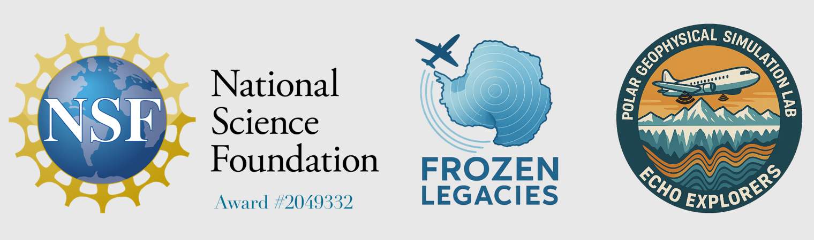

<p align="center">
  
</p>

# Frozen Legacies Tools

**Recovering ice-thickness measurements from historical Antarctic airborne radar film.**

Frozen Legacies Tools is a collection of three complementary Python workflows for recovering radar reflections and ice-thickness measurements from digitized 35-mm optical film collected during the **1974–1975 Scott Polar Research Institute (SPRI)–National Science Foundation (NSF)–Technical University of Denmark (TUD)** airborne radar survey. The workflows presented here focus on the **Ross Ice Shelf, Antarctica**.

The tools process two forms of historical radar imagery: **A-scope** amplitude-versus-time traces and **Z-scope** continuous radargrams. Each workflow supports recovering measurements from an archival record that was originally available on film.

> **This directory contains the ASTRA, LYRA, and TERRA workflows.** It does not include the earlier URSA and ARIES tools described in previous versions of the project documentation.

## Available tools

| Tool | Data type | Processing approach | Description |
| --- | --- | --- | --- |
| **[ASTRA](./Amplitude%20Signal%20Tracing%20and%20Retrieval%20Application%20%28A.S.T.R.A.%29/ASTRA.py)** — Amplitude Signal Tracing and Retrieval Application | A-scope | Interactive / semi-automatic | Calibrates oscilloscope time and amplitude grids and allows selection of the main bang, surface, bed, and noise floor. |
| **[LYRA](./Layered-echo%20Yield%20from%20Radiometric%20Archives%20%28L.Y.R.A.%29/lyra.py)** — Layered-echo Yield from Radiometric Archives | A-scope | Automated, with user-reviewed calibration | Identifies frames and CBDs, extracts waveforms, and detects surface and bed echoes using a multi-phase workflow. |
| **[TERRA](./Tracing%20and%20Extraction%20of%20Radar%20Reflections%20for%20Analysis%20%28T.E.R.R.A.%29/TERRA.py)** — Tracing and Extraction of Radar Reflections for Analysis | Z-scope | Semi-automatic | Uses operator-defined CBD positions and anchor points to trace surface and basal reflections along continuous radargrams. |

### How the tools differ

**ASTRA** is useful when an operator needs direct control of individual A-scope picks. The user calibrates the oscilloscope's time and amplitude scales and manually reviews the selected radar features.

**LYRA** is designed for more automated A-scope processing. It detects individual frames, associates frame identifiers (CBDs), extracts waveform information, and identifies candidate reflections. Calibration and quality-control steps still require user review.

**TERRA** is designed for continuous Z-scope imagery. The operator identifies CBD locations and supplies groups of anchor points that guide the semi-automatic surface and bed tracing.

The workflows are complementary; recovered picks should be inspected and validated rather than treated as error-free measurements.

## Repository layout

The folder names below match this release exactly:

```text
FrozenLegacies/
├── README.md                              # Existing repository-level README, if retained
├── frozenlegacytools_img.png             # Shared project banner
└── Frozen Legacies Tools/
    ├── README.md                         # This document
    ├── LICENSE.txt                       # MIT license for this code release
    ├── Amplitude Signal Tracing and Retrieval Application (A.S.T.R.A.)/
    │   └── ASTRA.py
    ├── Layered-echo Yield from Radiometric Archives (L.Y.R.A.)/
    │   ├── digit_templates.npy
    │   ├── digit_templates_expanded.npy
    │   └── lyra.py
    └── Tracing and Extraction of Radar Reflections for Analysis (T.E.R.R.A.)/
        └── TERRA.py
```

The two NumPy `.npy` files are digit-template resources used by **LYRA**; keep them with `lyra.py`.

**Important:** This GitHub folder contains the programs and LYRA templates, but **not the example TIFF images or navigation CSV files**. Download these input files from the Zenodo archive linked below before running the pickers.

## Installation

### Requirements

- **Python 3.10 or newer**
- Desktop GUI support, including **Tkinter**, for interactive operations
- Python packages: `numpy`, `pandas`, `scipy`, `matplotlib`, `pillow`, `opencv-python`, `pyproj`

Open a terminal in the `Frozen Legacies Tools` folder, then install the documented packages:

```bash
python -m pip install numpy pandas scipy matplotlib pillow opencv-python pyproj
```

Depending on the platform and script version, additional GUI components or dependencies may be needed. The command above follows the supplied tool documentation; the individual scripts were not provided for dependency testing.

## Sample data and recommended local structure

### Download the required TIFF and navigation files from Zenodo

**[Zenodo archive: Archival Airborne Radar Pickers](https://doi.org/10.5281/zenodo.24295998)**  
DOI: [`10.5281/zenodo.24295998`](https://doi.org/10.5281/zenodo.24295998)

To run **ASTRA** and **LYRA** (A-scope) or **TERRA** (Z-scope):

1. Open the Zenodo link above.
2. Download the **entire `Archival_AirborneRadar_Pickers.zip`** file, rather than downloading individual files.
3. Extract the ZIP. It contains the sample radar **`.tiff` image files** and matching **`.csv` navigation files** needed for the A-scope and Z-scope picker examples.
4. Use the extracted **A-scope TIFFs and navigation CSV** with ASTRA and LYRA, and the **Z-scope TIFFs and navigation CSV** with TERRA. Set the input paths in the example commands below to the locations where you extracted or copied the files.

The original package documentation organizes sample inputs under `AScope/tiff`, `AScope/nav`, `ZScope/tiff`, and `ZScope/nav`. You can work directly from those directories after extraction by editing the commands, or organize them in a local `sample-data` folder as illustrated below.

For example, the following *local working layout* may be used (the `sample-data` and `output` folders are **not currently part of the GitHub repository tree**):

```text
Frozen Legacies Tools/
├── [the three tool folders shown above]
├── sample-data/
│   ├── AScope/
│   │   ├── tiff/
│   │   │   └── F141-C0436_C0448.tiff
│   │   └── nav/
│   │       └── 141.csv
│   └── ZScope/
│       ├── tiff/
│       │   └── [example F141 Z-scope TIFF files]
│       └── nav/
│           └── 141.csv
└── output/
    ├── ASTRA/
    ├── LYRA/
    └── TERRA/
```

The Zenodo ZIP supplies the inputs for testing these pickers; it is not necessarily the complete historical radar archive. Adjust directory names and paths to where you actually store the extracted TIFF images and navigation CSV files.

## Running the workflows

Run these **example commands from inside `Frozen Legacies Tools`**, after downloading and extracting [`Archival_AirborneRadar_Pickers.zip`](https://doi.org/10.5281/zenodo.24295998) and organizing the example input/output folders above. The command-line argument patterns are adapted from the supplied `README.txt`; confirm their compatibility with the particular `.py` versions in your checkout.

### ASTRA — interactive A-scope picker

```bash
python "Amplitude Signal Tracing and Retrieval Application (A.S.T.R.A.)/ASTRA.py" --tiff "sample-data/AScope/tiff" --nav "sample-data/AScope/nav/141.csv" --output "output/ASTRA"
```

Set the appropriate oscilloscope **sweep rate** and calibrate the **time and amplitude axes** before accepting main-bang, surface, bed, and noise-floor selections. Review the exported picks and QC images.

### LYRA — automated A-scope processing

```bash
python "Layered-echo Yield from Radiometric Archives (L.Y.R.A.)/lyra.py" --tiff "sample-data/AScope/tiff" --nav "sample-data/AScope/nav" --output "output/LYRA"
```

Follow the interactive calibration prompts and inspect intermediate quality checks. For LYRA, `--nav` refers to the **navigation folder**, not an individual CSV file. Keep the `.npy` digit-template files in the LYRA script directory.

### TERRA — semi-automatic Z-scope picker

```bash
python "Tracing and Extraction of Radar Reflections for Analysis (T.E.R.R.A.)/TERRA.py" tiff "sample-data/ZScope/tiff" output "output/TERRA" nav "sample-data/ZScope/nav/141.csv"
```

Mark the CBD locations in each radargram, then use grouped anchor points to guide tracing of the surface and basal echoes. Inspect the resulting reflection picks and annotated images.

## Input file requirements

### Radar image TIFFs

- File format: TIFF (`.tif` or `.tiff`, as supported by the scripts).
- Historical images show either individual **A-scope traces** or continuous **Z-scope radargrams**.
- TIFF names identify the flight and CBD range; for example, `F141-C0436_C0448.tiff`.

### Navigation CSVs

- Navigation files provide the **CBD**, **LAT**, and **LON** fields used to associate measurements with positions.
- A flight-specific navigation file may be named, for example, `141.csv`.
- ASTRA and TERRA examples use a **specific navigation CSV**; LYRA's `--nav` example uses a **directory** containing navigation CSV files.

### Outputs

| Workflow | Expected outputs documented for the supplied versions |
| --- | --- |
| **ASTRA** | Radar pick tables (`.csv`) and quality-control imagery (`.png`). |
| **LYRA** | Intermediate processing results and extracted echo measurements (`.csv`) in flight-specific output subfolders. |
| **TERRA** | Digitized reflection measurements (`.csv`) and annotated radar images (`.png`). |

The software produces **radar-derived measurements**. Spatially varying **firn corrections are not applied by these workflows** and must be handled separately when needed for an ice-thickness product.

## Quality control and reproducibility

The archival record contains challenges such as film artifacts, variable echo quality, and calibration requirements. Before using any outputs in a scientific analysis:

1. Verify the **TIFF filename/CBD identifiers** and associated navigation entries.
2. Confirm the **time-axis/sweep-rate calibration** and, where applicable, the amplitude scale.
3. Inspect the **surface and bed picks** and the workflow-specific QC images or intermediate results.
4. Record processing choices and preserve inputs for reproducibility.
5. Apply any **firn correction or external validation** as a separate, documented analysis step.

## Project background and acknowledgment

The 1974–1975 **SPRI–NSF–TUD** survey recorded airborne ice-penetrating radar observations on optical film. The Frozen Legacies effort works to recover quantitative measurements from those archival images for modern glaciological analysis.

The project banner recognizes the **National Science Foundation (Award #2049332)**, **Frozen Legacies**, and the **Polar Geophysical Simulation Lab / Echo Explorers**.

## License

The source code in this release is made available under the **MIT License**. Read the full terms in **[LICENSE.txt](./LICENSE.txt)**.

The license applies to the software and its documentation; it should not be assumed to change rights or access conditions governing third-party archival radar images or navigation datasets.

## Contact

**Angelo Tarzona**  
Georgia Institute of Technology  
[tarzona@gatech.edu](mailto:tarzona@gatech.edu)

