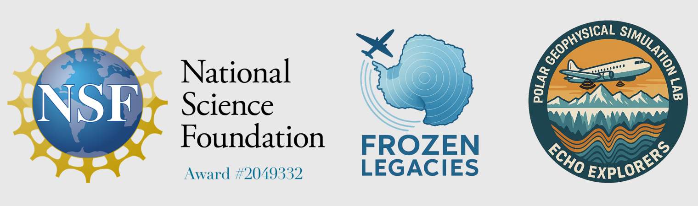

  

# Frozen Legacies | SPRI–NSF–TUD Antarctic Radar Archive

**Historical Antarctic radio-echo sounding data, processing tools, scientific references, and student research resources.**

This repository supports the recovery and analysis of historical airborne radar observations from the **1974–1975 Scott Polar Research Institute (SPRI)–National Science Foundation (NSF)–Technical University of Denmark (TUD)** campaign. It brings together Python processing workflows, relevant publications, and resources for REU students and mentees.

## Start here: current radar pickers

### **[Open Frozen Legacies Tools →](./Frozen%20Legacies%20Tools/)**

**For the current picker code, installation instructions, sample-data setup, and usage examples, visit the [Frozen Legacies Tools README](./Frozen%20Legacies%20Tools/README.md).**

This is the **recommended folder** for radar processing. It includes three complementary workflows:

| Tool | Radar format | Approach | Purpose |
| --- | --- | --- | --- |
| **[ASTRA](./Frozen%20Legacies%20Tools/Amplitude%20Signal%20Tracing%20and%20Retrieval%20Application%20%28A.S.T.R.A.%29/ASTRA.py)** — Amplitude Signal Tracing and Retrieval Application | A-scope | Interactive / semi-automatic | Calibrates oscilloscope time and amplitude scales and picks main bang, surface, bed, and noise floor. |
| **[LYRA](./Frozen%20Legacies%20Tools/Layered-echo%20Yield%20from%20Radiometric%20Archives%20%28L.Y.R.A.%29/lyra.py)** — Layered-echo Yield from Radiometric Archives | A-scope | Automated with user-reviewed calibration | Identifies film frames and CBDs, extracts waveforms, and detects surface and basal echoes. |
| **[TERRA](./Frozen%20Legacies%20Tools/Tracing%20and%20Extraction%20of%20Radar%20Reflections%20for%20Analysis%20%28T.E.R.R.A.%29/TERRA.py)** — Tracing and Extraction of Radar Reflections for Analysis | Z-scope | Semi-automatic | Uses CBD locations and operator-defined anchor points to trace reflections in continuous radargrams. |

> **Important:** The similarly named `Frozen Legacy Tools` folder (without **“Legacies”**) contains an earlier collection of ASTRA, ARIES, TERRA, and URSA code. It is **legacy material and not the recommended starting point**. That folder is being reviewed for retirement; use **[Frozen Legacies Tools](./Frozen%20Legacies%20Tools/)** for the current ASTRA, LYRA, and TERRA workflows.

## Download the example radar data

The current GitHub picker folder contains the code and LYRA digit templates, **not the example A-scope and Z-scope radar files**.

**[Download the sample-data archive from Zenodo](https://doi.org/10.5281/zenodo.24295998)** — DOI: `10.5281/zenodo.24295998`

On the Zenodo record, download the **entire `Archival_AirborneRadar_Pickers.zip`** and extract it. The archive supplies the sample **`.tiff` radar images** and **`.csv` navigation data** needed to run the A-scope pickers (**ASTRA and LYRA**) and the Z-scope picker (**TERRA**). Follow the [tool-specific setup and run instructions](./Frozen%20Legacies%20Tools/README.md) to point each program to the corresponding extracted files.

These files provide examples for running the pickers; do not confuse them with the complete historical film archive.

## Other repository resources

| Directory | Contents |
| --- | --- |
| **[Frozen Legacies Tools](./Frozen%20Legacies%20Tools/)** | Current ASTRA, LYRA, and TERRA Python workflows and their documentation. |
| **[Papers](./Papers/)** | Scientific references and documents concerning survey positioning, radar methods, and historical data collection. |
| **[REU_and_Mentees](./REU_and_Mentees/)** | Reading guidance, project resources, and semester-specific material for undergraduate researchers and mentees. |

The repository root also contains a `Dockerfile`, a `LICENSE`, and this `README.md`. For license information specific to the current picker release, see its [LICENSE.txt](./Frozen%20Legacies%20Tools/LICENSE.txt).

## Data availability and navigation

- **Historical film archive:** Explore the SPRI–NSF–TUD radar observations through [Radar Film Studio](https://www.radarfilm.studio/). For access to additional A-scope or Z-scope data beyond the Zenodo examples, contact Angelo Tarzona (`tarzona@gatech.edu`).
- **Historical positioning:** Flight navigation and original-positioning resources can be found in the [Radar Film Studio GitHub repository](https://github.com/radioglaciology/radarfilmstudio/tree/2beee065a5b9bbdda5369d91507a6dca5a48cd5f/antarctica_original_positioning).
- **Examples for running these pickers:** Download [`Archival_AirborneRadar_Pickers.zip` on Zenodo](https://doi.org/10.5281/zenodo.24295998), then consult the [Frozen Legacies Tools instructions](./Frozen%20Legacies%20Tools/README.md).

## For REU students and mentees

Begin with **[REU_and_Mentees](./REU_and_Mentees/)** for the reading guides and mini-syllabus. Next, review the literature in **[Papers](./Papers/)**. When ready to work with the historical radar film, use the **[current picker workflows](./Frozen%20Legacies%20Tools/)** and their documented example inputs. For questions about calibration and processing, contact Angelo Tarzona.

## Scientific background

The 1974–1975 SPRI–NSF–TUD campaign recorded Antarctic radar observations on film, including discrete **A-scope** amplitude traces and continuous **Z-scope** radargrams. Reprocessing these historical records enables quantitative analysis and comparison with later measurements, including recovered ice-thickness estimates over the Ross Ice Shelf.

For foundational reading on positioning, survey techniques, and archival data analysis, see the publications collected under **[Papers](./Papers/)**, including the works identified in the previous repository README by Millar et al. (1981), Drewry et al. (1982), Bingham and Siegert (2009), Schroeder et al. (2019), and Karlsson et al. (2024).

---

**Current tool documentation:** [Frozen Legacies Tools / README.md](./Frozen%20Legacies%20Tools/README.md)
